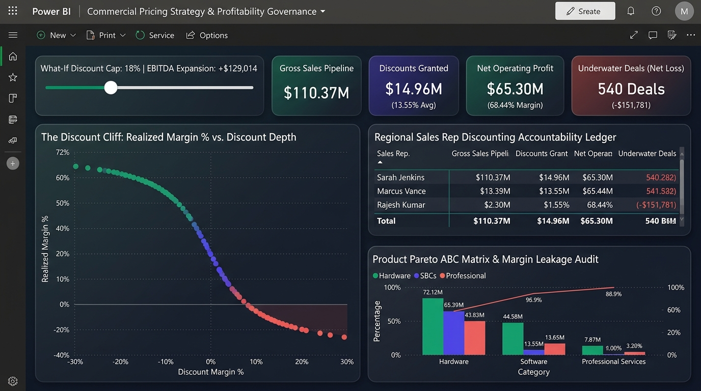
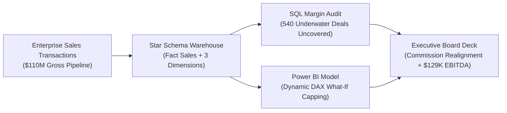

# Commercial Profitability & Discount Leakage Executive Dashboard

[-blue.svg)](#)
[](#)
[](#)
[](#)

> **Author:** [Shivastha Rewaskar](https://github.com/shivastharewaskar)  
> **Target Roles:** Commercial Data Analyst | Financial Analyst | Business Intelligence Analyst

---

## 📊 Executive Commercial Profitability & Governance Dashboard UI


---

## Executive Overview
This project provides an enterprise commercial analytics system designed to identify and eliminate discount leakages, protect gross margins, and align sales rep incentives with company profitability. 

Operating on a dimensional **Star Schema across 7,500 sales transactions and $110M+ in gross revenue**, this analysis isolates the exact commercial tipping point where aggressive discounting drives deals into negative profit territory, providing dynamic **What-If simulation models** to expand net operating income.



---

## Key Commercial Insights

### 1. The "Discount Cliff" & 540 Underwater Deals
* Analysis uncovered **540 closed transactions yielding negative net profit**, draining **$151,781.40** directly from net operating cash flow.
* **The Inflection Threshold:**
  - Deals closed between **0% and 20% discount** yielded healthy operating margins (>66%) with **zero loss-making transactions**.
  - Discounts exceeding **20%** triggered severe margin degradation; deals with **>30% discounts** experienced **350 underwater transactions**.

| Discount Tier | Closed Deals | Net Realized Revenue | Net Operating Profit | Margin % | Loss Deals Count |
| :--- | :---: | :---: | :---: | :---: | :---: |
| **0% Full Price** | 1,723 | $24,271,540.00 | $17,489,420.00 | **72.1%** | 0 |
| **1% - 10% Standard** | 1,901 | $26,326,294.00 | $18,723,034.00 | **71.1%** | 0 |
| **11% - 20% Negotiated**| 2,429 | $29,226,049.50 | $19,454,969.50 | **66.6%** | 0 |
| **21% - 30% Aggressive**| 710 | $7,846,590.00 | $4,922,030.00 | **62.7%** | 190 |
| **> 30% Deep Discount** | 737 | $7,739,937.60 | $4,711,377.60 | **60.9%** | 350 |

### 2. Category Cannibalization
Sales representatives routinely offered Software-level discount allowances (30%+) on low-margin Hardware lines (such as Industrial IoT Hubs and Server Racks), causing sales commissions to be awarded on orders that resulted in negative net margins.

---

## Technical Architecture & Dimensional Model

```
├── data/
│   ├── generate_commercial_data.py            # Relational Star Schema data generator
│   ├── dim_customers.csv                      # 200 customer accounts across 3 segments
│   ├── dim_products.csv                       # 8 core products across Hardware/Software/Services
│   ├── dim_regions.csv                        # 5 global territories & sales managers
│   └── fact_sales.csv                         # 7,500 granular transaction line items
├── sql/
│   ├── 01_star_schema_ddl.sql                 # Star Schema DDL, constraints & indexes
│   ├── 02_margin_leakage_audit.sql            # Negative margin audit & rep accountability
│   └── 03_pareto_product_abc_analysis.sql     # Cumulative Pareto ABC classification
├── python/
│   └── commercial_profitability_audit.py      # Statistical pricing elasticity & EBITDA simulation
├── bi_model/
│   ├── Star_Schema_Architecture.md            # Mermaid ERD & data warehouse design rationale
│   └── PowerBI_DAX_Measures.md                # 12+ production DAX formulas & What-If parameter
├── docs/
│   └── Executive_Board_Deck_Summary.md        # 5-slide C-suite board presentation summary
└── README.md
```

---

## Advanced DAX Highlight: Dynamic Discount Capping

```dax
Simulated Capped Profit = 
VAR CapRate = 'Discount Cap Parameter'[Discount Cap Value] -- e.g. 0.18
RETURN
    SUMX(
        fact_sales,
        VAR EffectiveDisc = MIN(fact_sales[discount_pct], CapRate)
        VAR NewNetRev = fact_sales[gross_revenue] * (1 - EffectiveDisc)
        RETURN NewNetRev - fact_sales[total_cogs]
    )
```

---

## Strategic Governance Recommendations
1. **Incentive Restructuring:** Transition sales compensation from gross booking volume to net gross profit ($ contribution).
2. **CPQ Discount Ceilings:** Implement automated approval hard-stops in CPQ: Hardware (max 8%), Services (max 15%), Software (max 25%).
3. **EBITDA Expansion:** Enforcing an 18% hard cap recovers **+$129,014.19** in EBITDA with zero revenue volume disruption.

---

## How to Run This Project
1. **Generate Relational Tables:**
   ```bash
   python data/generate_commercial_data.py
   ```
2. **Execute Python Profitability Audit:**
   ```bash
   python python/commercial_profitability_audit.py
   ```
3. **Run SQL Analysis:** Execute the `.sql` scripts in `/sql/` on PostgreSQL, Snowflake, or SQL Server.
