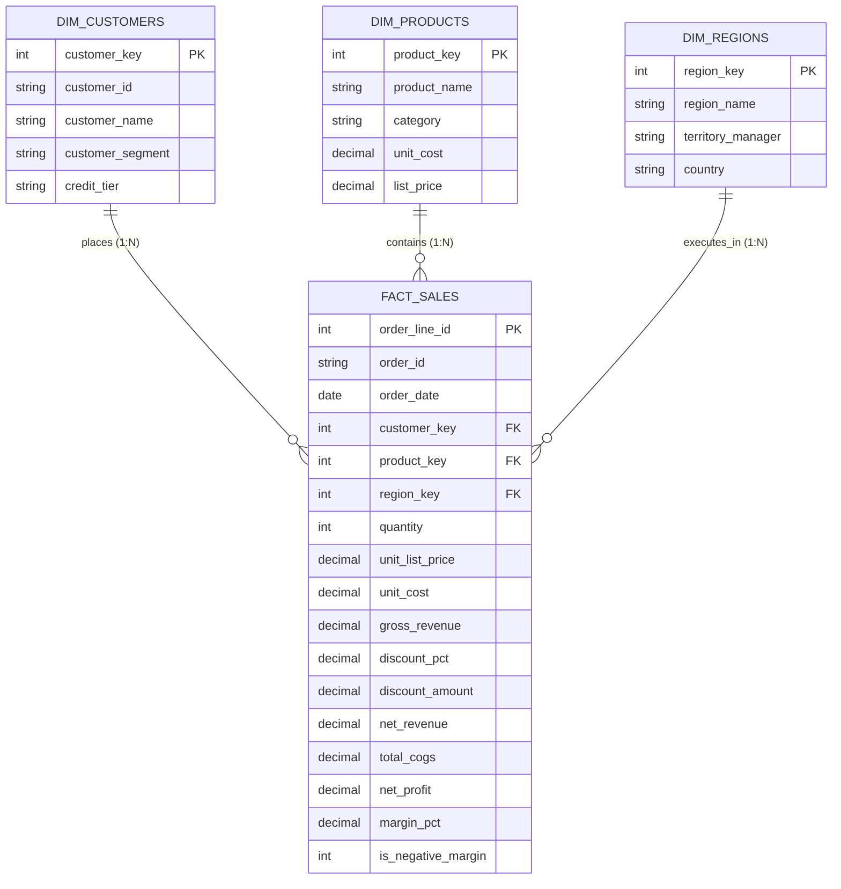

# Star Schema Enterprise Architecture & Data Modeling
**Project:** Commercial Profitability & Discount Leakage Executive Dashboard  
**Author:** Shivastha Rewaskar  

---

### Entity Relationship Diagram (ERD) - Star Schema (1-to-Many)

---

### Data Warehouse Design Principles Applied

1. **Dimensional Integrity & Normalization:**
   - Single-grain transactions captured in `fact_sales` at the individual order-line level.
   - Dimension tables (`dim_customers`, `dim_products`, `dim_regions`) are normalized to eliminate duplicate descriptive text and optimize memory consumption in VertiPaq / Power BI.
2. **Surrogate Keys:**
   - Integer surrogate keys (`customer_key`, `product_key`, `region_key`) used for lightning-fast join performance, isolating the warehouse from upstream source system changes.
3. **Additive vs. Semi-Additive Measures:**
   - Fully additive: `Gross Revenue`, `Discount Amount`, `Net Revenue`, `Total COGS`, `Net Profit`.
   - Non-additive / Calculated via DAX: `Margin %`, `Average Discount %`, `Discount Leakage Index`.
